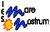
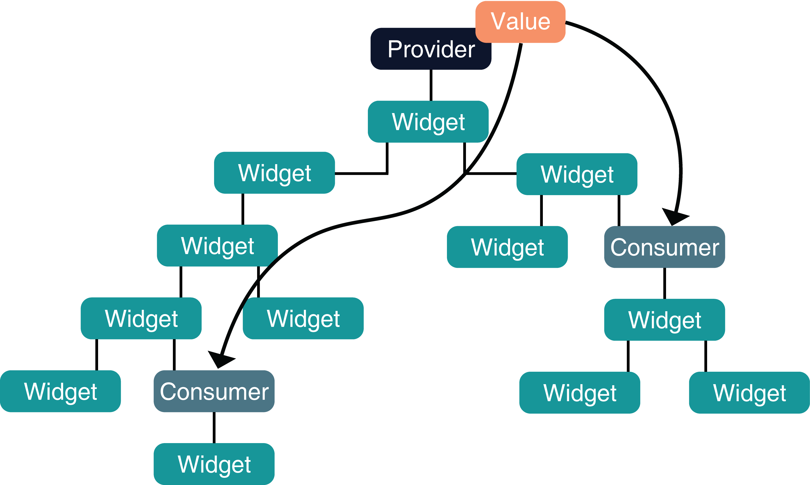
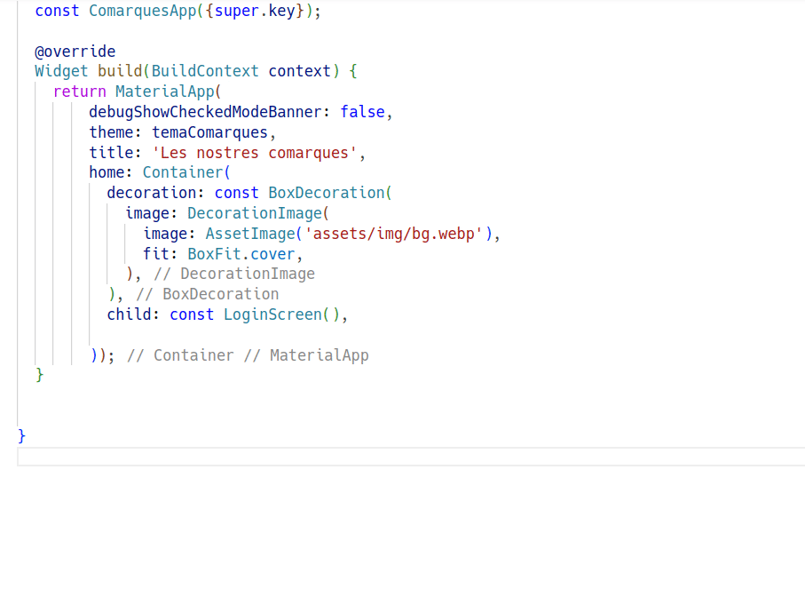

   

<br>
<br>
# Unidad 6. Patrones arquitectónicos y gestión del estado.


El estado de una aplicación se compone de los datos con que esta trabaja, y que cambian a lo largo del ciclo de vida.

A lo largo del curso, hemos visto con los widgets de tipo *Stateful* cómo gestionar el estado del propio widget mediante `setState()`, por lo que cualquier cambio de estado se refleja de forma inmediata en la interfaz.

A medida que una aplicación crece y los datos deben estar presentes en varios sitios, necesitamos mecanismos que nos permitan preservar su estado, y mantener esa reactividad que se espera de las aplicaciones modernas. Es aquí donde los patrones de diseño arquitectónicos y de gestión de estado nos serán de gran ayuda.

En esta unidad veremos uno de los patrones más comunes cuando se trabaja con Flutter: El patrón Provider. Existen otros patrones 


[1. Introducción a los patrones de diseño](#_apartado1)

[2. El Patrón Provider](#_apartado2)

[3. Provider en acción. Adaptación de la app de comarcas](#_apartado2)


# <a name="_apartado1"></a>1. Introducción a los patrones de diseño

Los datos con los que trabajan nuestras aplicaciones y que cambian a lo largo del ciclo de vida de estas conforman lo que se conoce como el estado de la aplicación.

En Flutter hemos visto en los widgets de tipo Stateful cómo gestionar el estado del propio widget, mediante `SetState()`, de modo que cualquier cambio de estado se refleja de forma inmediata en la interfaz (decimos que las interfaces son reactivas).

A medida que una aplicación crece y los datos deben estar presentes en varios sitios, los widgets con estado, a pesar de ser muy útiles en determinadas situaciones, pueden resultar insuficientes para gestionar el estado de la aplicación.

## ¿Por qué patrones de diseño arquitectónicos para manejar el estado?

Imaginemos que estamos creando una app que tiene varias pantallas, y todas ellas necesitan acceder a los mismos datos.

En este caso se nos puede ocurrir crear una clase global, de forma que todas las pantallas tengan acceso. Sólo debería tratarse de widgets con estado, el cual se inicializará a partir del estado de la aplicación, y se irá actualizando reactivamente con `SetState()`. Los cambios en el estado global simplemente se producirían modificando los datos del mismo desde los diversos widgets.

Sin embargo, esta aproximación presenta varios inconvenientes.

- En primer lugar, en cuanto a la inicialización, actualización y seguimiento de los datos, que afecta al rendimiento. Cada vez que se invoca setState(), además de reconstruir el widget, se reconstruyen también todos sus descendientes, lo que puede acarrear muchas reconstrucciones de widgets, sobre todo si el estado global cambia a menudo, y más aún si tiene una estructura compleja.
  
- Por otra parte, comporta una mayor dificultad a la hora de mantener y probar el código. Como cada widget puede modificar el estado global, puede ser difícil seguir el rastro de cuándo y dónde se modifica éste, y por tanto, nuestro código sea más difícil de comprender y mantener.
  
- Esta aproximación también supone un fuerte ensamblaje de los diferentes widgets con el objeto global, ya que si cambiamos su representación, todos los widgets que dependen de él deberían modificarse. Esto también supondrá una dificultad añadida a la hora de probar los distintos widgets.
  
- Además, si distintos widgets modifican al mismo tiempo este estado global, no podríamos asegurar que estén haciendo uso de una versión consistente de este.

Muchos de estos problemas podrían ir resolviéndose uno a uno,pero... ¿no sería preferible una solución global que nos los resolviera todos de una?

Para dar solución a esta problemática y facilitar el crecimiento de las aplicaciones planteamos una organización coherente, mediante el uso de patrones o modelos de diseño arquitectónico de software. Estos modelos describen diferentes organizaciones de los componentes, así como la interacción entre ellos y las posibles restricciones de uso, proporcionando una forma más estructurada y previsible de gestionar el estado, facilitar la prueba de código, y permitir un mayor control sobre las actualizaciones del estado y de la interfaz de usuario.

## Patrones de diseño

Algunos de los patrones de diseño  más populares son:

- El patrón **MVC o Modelo-Vista-Controlador**, compuesto por tres componentes principales: el *Modelo*, responsable de la gestión de los datos, la *vista*, que representa la interfaz de usuario, y el *Controlador*, que es quien contiene la lógica de negocio, desde la gestión de los eventos hasta el cambio de vistas o acceso a los datos.
  
- El patrón **MVP o Modelo-Vista-Presentador**, que alivia la carga del controlador, extrayendo el trabajo que realizaba éste a una nueva entidad llamada Presenter, encargada de la organización y coordinación entre el modelo y la vista.
  
- El patrón **MVVM o Modelo-Vista-ViewModel**, que se basa en flujos observables y divide las aplicaciones en tres componentes: El *modelo*, que se encarga de obtener los datos desde cualquier fuente y exponerlos a los *ViewModels*; la *vista*, que se encarga de mostrar la interfaz de usuario y gestionar la interacción con el usuario, y el *ViewModel*, situado entre la vista y el modelo, y que se encarga de obtener los datos del modelo y exponerlos a la interfaz mediante eventos que las vistas puedan observar. Este componente ViewModel, gracias a los flujos observables, permite que la interfaz tenga un componente más reactivo o automatizado.

Podemos consultar los siguientes artículos relacionados :

[Why We Never Manage State with Global Variable in Flutter](https://medium.com/@chooyan/why-we-never-manage-state-with-global-variable-in-flutter-3e92f41ac8fa)

[Flutter Global State Essentials: Building and Managing Dynamic UIs](https://www.dhiwise.com/post/flutter-global-state-essentials-building-dynamic-uis)


# <a name="_apartado2"></a>2. El Patrón Provider.

En este apartado, vamos a ver el patrón arquitectónico y de gestión de estado **Provider**, desarrollado por la comunidad, y presentado en Google I/O 2019, como alternativa al patrón **BLoC**, pero que no es uno más de los múltiples que existen, como *Redux*, *Riverpod* o *getX* entre otros.

## Provider

El paquete ***Provider***, de [Dash Overflow](https://pub.dev/publishers/dash-overflow.net/packages), como se ha comentado, permite la gestión del estado de las aplicaciones de forma relativamente sencilla. A pesar de no tratarse de un paquete propio de Google, la empresa anima a su uso, y colabora en su desarrollo.

En la [documentación del paquete](https://pub.dev/packages/provider) se define a *Provider* como "*una cubierta (wrapper) sobre el tipo de widget InheritedWidget para hacerlos más fáciles de utilizar y más reutilizables*".

Cuando tratamos la unidad de Widgets, introdujimos los widgets con estado y los widgets sin estado, y de paso, en el ciclo de vida mencionamos los widgets *InheritedWidget*. En esencia, se trata de una clase base que permite la propagación de información por el árbol de widgets, y que hacen que aquellos widgets que lo utilizan (consumidores) se reconstruyan ante un cambio de estado.

La aparición de los widgets *InheritedWidget* se vio motivada por esta necesidad de compartir información en el árbol de widgets, sin tener que proporcionar toda una entidad con datos en la navegación de un widget a otro. Generalmente, estos tipos de widget serán el widget padre del resto.

Sin embargo, este tipo de widgets presentan cierta complejidad en su uso, principalmente a la hora de consumir y actualizar los datos. Para darle una solución sencilla, apareció *Provider*, como una clase descendente de *InheritedWidget*, y que facilita la gestión de información.

Así pues, *Provider* puede verse como un sistema de inyección de dependencias (mecanismo para compartir objetos entre clases) consistente en añadir mejoras (o azúcar sintáctico) para hacer más usables los *InheritedWidgets*.

### Clases principales y funcionamiento

Antes de entrar en materia, vemos las principales clases que nos aporta la librería Provider y su funcionamiento:

- `Provider`: Ésta es la clase base que nos permite crear y exponer valores, y proporciona instancias a cualquier widget del árbol. Un método estático muy interesante de esta clase es el método `Provider.of`, que podemos parametrizar con un tipo genérico de `Provider` y proporcionarle el contexto, para que nos devuelva el *Provider* del tipo indicado en el árbol de widgets
  
- `Consumer`: Se trata de un tipo de widget que permite a sus hijos suscribirse a un `Provider` y recibir sus actualizaciones de estado. Cuando un `Provider` cambia su estado, notifica a todos los *Consumers*. Internamente hace uso del método `Provider.of` que hemos comentado anteriormente.
  
- `Selector`: Se trata de una clase similar a `Consumer`, con la diferencia de que sólo actualiza el widget cuando cambia una parte concreta del estado.
  
- `ChangeNotifier`: Se trata de una clase abstracta que permite crear objetos de tipo `Provider`, y que por tanto, puedan emitir notificaciones a los widgets cuando sus datos cambian, mediante el método `NotifyListeners`.
  
- `ChangeNotifierProvider`: Se trata de una subclase de `Provider` que proporciona un objeto de tipo `ChangeNotifier` al árbol de widgets, y se encargará de notificarlos ante cambios de estado. Se trata de la clase que generalmente utilizaremos para crear nuestro `Provider` y que será quien contenga tanto el estado que queremos compartir en la aplicación como la lógica de negocio.
  
- `MultiProvider`: Este widget nos permite crear un árbol de Providers a partir de una lista de widgets, generalmente de tipo `ChangeNotifierProvider`. Cuando trabajemos con aplicaciones que requieran de varios `Providers`, haremos uso de este widget.

El funcionamiento por lo general del patrón es el siguiente.

- En primer lugar, definimos a nuestro `Provider`, generalmente como un mixin con la clase `ChangeNotifier`, y que contendrá el estado de la aplicación que queremos compartir y aplicará también la lógica de negocio.
  
- Cuando vayamos a hacer uso del estado de este Provider en una parte del árbol de widgets, crearemos un widget `ChangeNotifierProvider` que ubicaremos como padre de esta parte del árbol (haremos un wrap de esta parte del árbol con el ChangeNotifierProvider). Esta clase tiene un componente `create` (builder en versiones anteriores), consistente en una función que recibe el contexto, y devuelve una instancia del `Provider`.
  
- Los widgets hijos del `ChangeNotifierProvider`, pueden suscribirse a las propiedades del estado del `Provider` de diversas formas, bien con el método `Provider.of` o los widgets `Consumer` o `Selector`.
  
- Cuando se produce un cambio de estado, el Provider notifica a todos sus suscriptores utilizando el método `notifyListeners()`, que incorpora de la clase `ChangeNotifier`.

Con este funcionamiento, podemos disponer de una estructura jerárquica que comparte valores y los actualiza en tiempo real sin necesidad de proporcionar datos de los argumentos.



# <a name="_apartado3"></a>3. Provider en acción. Adaptación de la app de comarcas.

Vamos a ver cómo haríamos la adaptación de nuestro proyecto de comarcas. Para ello, partimos de la estructura de carpetas que ya teníamos implementada, donde separábamos vistas, repositorios y servicios.

## Instalación de la librería y estructura del proyecto

Recordemos que `Provider` se distribuye en forma de paquete de Dart, por lo que lo primero que debemos hacer es instalar éste con:

```
flutter pub add provider
```

Esto nos añadirá al archivo `pubspec.yaml` la dependencia en el paquete. En nuestro caso, la versión actual del paquete es la 6.1.2, por lo que incorporará como dependencia esa versión o superior:

```yaml
dependencies:
  ...
  provider: ^6.1.2
```

Después añadiremos la carpeta Provider a nuestra estructura de carpetas. De momento, tendremos:

```
lib/
├── models
│   ├── comarca.dart
│   └── provincia.dart
├── providers
├── repository
│   ├── repository_comarques.dart
│   └── repository_weather.dart
├── screens
│   └── ...
└── services
    ├── comarques_service.dart
    └── weather_service.dart
```

## Creación de los Providers

Dentro de la carpeta providers, crearemos el archivo `comarcas_provider.dart`.

En este fichero, importaremos la librería `foundation` y crearemos la clase `ComarcasProvider` como un mixin con la clase `ChangeNotifier`, de modo que la nueva posea también las capacidades de ésta:

```dart
import 'package:flutter/foundation.dart';

class ComarcasProvider with ChangeNotifier {...}
```

<hr>

El módulo foundation que estamos importando es la base del framework Flutter, sobre la que se construyen el resto de capas y módulos, entre las que se encuentran otros módulos como *Widgets*, *Material* o *Cupertino*. Si no añadimos ninguna libería, nos indicaría que no puede encontrar la clase `ChangeNotifier` y nos sugeriría importar bien la librería *foundation*, *widgets*, *material* o *cupertino*. Dado que no necesitamos ningún componente gráfico más específico en este archivo, basta con importar *foundation*.

<hr>

<hr>

Recuerde también que el lenguaje Dart contempla a los `Mixins` como una aproximación a la herencia múltiple, y supone un mecanismo más potente que el uso de interfaces. Un mixin implicaba que una clase definida como tal incorpora las capacidades (propiedades y comportamiento) de otras clases, sin necesidad de utilizar la herencia y evitar los problemas derivados de la herencia múltiple.

<hr>

De esta forma, ahora, nuestra clase `ComarcasProvider` podrá utilizar los métodos de la clase `ChangeNotifier`.

Una vez definida la clase, creamos las propiedades de esta, que será la información que querremos compartir en la aplicación:

- `provincias`, con la lista de las provincias una vez se han cargado,
  
- `_provinciaActual`, consistente en una cadena que contendrá la última provincia que se ha seleccionado
  
- `comarcas`, con la lista de comarcas correspondientes a la provincia seleccionada,
  
- `_comarcaActual`, consistente en una cadena con la comarca seleccionada,
  
- `infoComarca`, una instancia de Comarca con la información de la comarca seleccionada actualmente.

Con esto, la clase quedaría:

```dart
class ComarcasProvider with ChangeNotifier {

  // Propiedades para almacenar el estado en el Provider
  String? _provinciaActual;
  List<dynamic>? listaComarcas;
  String? _nombreComarcaActual;
  Comarca? comarcaActual;
  List<Provincia>? provincias;

  ...
}
```

Podría suceder que nuestro repositorio fuera sin métodos estáticos, en cuyo caso deberíamos mantener una referencia a un objeto del mismo (no es nuestro caso):

```dart
final _comarcasRepository = RepositoryComarcas();
```

Una vez que tenemos las propiedades, vamos a ver qué aspecto tienen los métodos de acceso necesarios y qué métodos auxiliares necesitarán para aplicar la lógica de negocio.

Antes, sin embargo, vamos a echar un vistazo al método constructor del Provider, que tiene el siguiente código:

```dart
  ComarcasProvider() {
    // En el momento que creamos el provider
    // habrá que cargar la lista de provincias
    _cargarProvincias();
  }

  void _cargarProvincias() async {
    // Obtenemos las provincias desde el método correspondientes del repositorio
    provincias = await RepositoryComarcas.obtenerProvincias();

    notifyListeners();
  }
```

Como hemos modificado una propiedad del estado, queremos que todos los widgets que estuvieran suscritos a este valor se enteren de este cambio. Para ello, utilizamos el método `notifyListeners()`.

Si las estructuras de datos que recibimos del repositorio no son las que espera la interfaz, habrá que realizar un mapeado antes de hacer `NotifyListeners()`.

### Métodos de acceso para la provincia actual

La propiedad `_provinciaActual` es una propiedad privada que simplemente tiene la función de controlar cuál es la provincia seleccionada actualmente; o lo que es lo mismo, a qué provincia pertenece la lista de comarcas cargada. Esta propiedad, por la lógica de la aplicación, en principio no necesita ningún método de acceso de tipo get, ya que sólo se usará internamente en el Provider, pero sí tendrá un método set que, además de actualizar internamente esta provincia, cargará la lista de comarcas.

El funcionamiento interno del método será: Comprueba si el valor proporcionado para actualizar la provincia es diferente a la provincia actual (o bien si ésta es null), y en su caso, la actualiza y carga la lista de comarcas. De lo contrario, no hará nada.

Vemos el código completo:

```dart
set provinciaActual(String provincia) {
  // Actualizamos la provincia actual
  if (_provinciaActual == null || _provinciaActual != provincia) {
    listaComarcas = null; // Con esto conseguimos que aparezca el indicador de progreso en lugar de las comarcas anteriores
    _provinciaActual = provincia;

    // Cargamos la lista de comarcas de la província
    _cargarComarcas(provincia);
  }
}
```

Como vemos, este método invoca al método interno `_cargarComarcas()`, proporcionándole la provincia de la que queremos cargar las comarcas.

```dart
void _cargarComarcas(String provincia) async {
    // Cargamos la lista de comarcas
    List<dynamic> jsonComarcas =
        await RepositoryComarcas.obtenerComarcas(provincia);
    // Actualizamos el estado
    listaComarcas = jsonComarcas;
    // Y notificamos a todos los listener que estén pendientes del Provider
    notifyListeners();
  }
```

Como vemos, se trata de un método `async` que pide la lista de comarcas (con el nombre y la imagen) en el repositorio, y actualiza con la respuesta la lista de comarcas del Provider. Una vez actualizada la lista, será necesario notificar todos los widgets que estuvieran suscritos a ella con el método `notifyListeners`.

<hr>

¿Por qué añadimos `notifyListeners()` al final de` _cargaComarcas` y no al final del método `set`?

Si nos damos cuenta, el método `set` no se espera a que finalice el método de carga de las comarcas. De hecho, un método de tipo set no puede ser asíncrono. Cuando se invoca al método `_cargarComarcas`, el método `set` finaliza, pero la carga de las comarcas todavía está en proceso, por lo que la notificación a los widgets suscritos deberá realizarse una vez se ha actualizado la lista de comarcas.

<hr>
<hr>

Para qué sirve establecer `comarcas=null;` en el método `set`?

Cuando tenemos una lista de comarcas cargada y queremos mostrar las comarcas de otra provincia, en el momento que hagamos clic sobre la nueva provincia, la vista renderizaría la lista de comarcas que tiene cargada el Provider, y que serían las de la provincia seleccionada anteriormente. En el momento que se cargara la nueva lista se actualizaría la vista de forma automática, pero en el momento de hacer clic, veríamos las comarcas que no tocan.

Para evitar esto, lo que hacemos es limpiar esta lista de comarcas (poniéndola a null), para que aparezca el indicador de progreso mientras se cargan.

<hr>

### Métodos de acceso para la comarca actual

La propiedad `_nombreComarcaActual` contiene un String nulable con la comarca seleccionada actualmente. Esta comarca podrá ser leída (necesitará un método `get`) y también modificada (método `set`). Además de actualizar la comarca, este método `set` lo que hará será cargar la información de esta comarca y actualizar la propiedad `comarcaActual` del Provider.

Vemos el código:

```dart
String get nombreComarcaActual {
  return _nombreComarcaActual!;
}

set nombreComarcaActual(String comarca) {
  // Actualizamos la comarca actual

    if (_nombreComarcaActual == null || _nombreComarcaActual != comarca) {
      _nombreComarcaActual = comarca;

      comarcaActual = null;

      // Cargamos la información de la comarca
      _cargarComarca(comarca);
    }
  }
```

Como vemos, la estructura del `set` es prácticamente la misma que hemos utilizado para el `set` de la provincia actual, actualizando a null la información de la comarca actual (comarcaActual) mientras se está cargando la información correcta.

El método interno `_cargarComarca` se encargará de obtener la información de la comarca desde el repositorio y actualizar ésta al Provider. Hecho esto, notificará a todos los widgets suscritos con `notifyListeners`:

```dart
void _cargarComarca(String comarca) async {
  // Obtenemos la información sobre la comarca a través del repositorio, 
  // y actualizamos la comarca ctual

  comarcaActual = await RepositoryComarcas.obtenerInfoComarca(comarca);

  // Notificamos a los consumidores de este provider
  notifyListeners();
}
```

Con esto ya tendríamos todo el **Provider completo**. 

## Añadiendo el ChangeNotifierProvider

Para *consumir* los datos del *Provider* en una parte del árbol de widgets, tal y como hemos comentado, debemos incorporar un widget `ChangeNotifierProvider` que cubra (wrap) esta parte del árbol. Si sólo necesitamos acceder al *Provider* en una parte específica del árbol, por cuestiones de rendimiento es conveniente incorporar el `ChangeNotifierProvider` lo más cerca de esta parte del árbol, ya que así las notificaciones sólo se envían a los widgets necesarios.

En nuestro caso, y como necesitaremos la lista de las provincias ya en la pantalla inicial, vamos a proporcionar acceso al Provider a toda la aplicación, envolviendo directamente el widget `MaterialApp` con el `ChangeNotifierProvider`.

Como hemos comentado, el widget `ChangeNotifierProvider` requiere de un componente `create` que recibirá el `context`, y deberá devolvernos un objeto de tipo `ComarcasProvider`. Aparentemente, todo será igual, pero ahora todos los widgets descendentes de `MaterialApp`, es decir, toda la aplicación, podrá suscribirse a las propiedades del estado del *Provider* de diversas formas, bien con el método `Provider.of` o los widgets `Consumer` o `Selector`.

Vemos este proceso en la siguiente animación:



Por último, el `build` de nuestra app quedará de la siguiente forma:

```dart
Widget build(BuildContext context) {
    return ChangeNotifierProvider(
      create: (BuildContext context) => ComarcasProvider(),
      child: MaterialApp(
        title: 'Nuestras Comarcas',
        debugShowCheckedModeBanner: false,
        theme: temaComarques,
        home: const Scaffold(
          body: ProvinciasScreen(),
        ),
      ),
    );
  }
```

## Acceso a las propiedades desde las vistas

Por último, vamos a ver cómo acceder a las diferentes propiedades del *Provider* desde las vistas, tanto para actualizarlas como para suscribirse a las notificaciones.

El procedimiento será similar a todas las vistas, y consistirá en los siguientes pasos:

1. Importar la clase *Provider* de la libería (`package:provider/provider.dart`) y nuestro Provider (`comarcas_provider.dart`).
   
2. Dentro del método `build` de cada widget, instanciamos a nuestro *Provider*. Haremos uso directamente del método `Provider.of` de la clase Provider, en lugar de utilizar los widgets `Consumer` o `Selector`:

```dart
Widget build(BuildContext context) {
    // Creamos una instancias del provider
    var providerComarcas = Provider.of<ComarcasProvider>(context);
    ...
}
```

Con esta instancia de `ComarcasProvider` vamos a poder interactuar con el *Provider* e intercambiar información entre los widgets.

Vemos la **adaptación a las distintas pantallas**.

<br>

## Vista de Provincias

Empecemos por la pantalla principal, con las provincias (`lib/screens/provincias_screen.dart`).

En primer lugar, importamos las librerías comentadas (entre otras), y en el método `build` instanciamos en primer lugar, obtenemos la instancia del `ComarcasProvider`, y después devolvemos el widget en sí, que consistirá en un `Scaffold` que contiene en su cuerpo un `SingleChildScrollView` con un `Column` centrado, con la lista de widget que representan las provincias:

```dart
...
import 'package:flutter/material.dart';
import 'package:provider/provider.dart';

class ProvinciasScreen extends StatelessWidget {
  const ProvinciasScreen({super.key});

  @override
  Widget build(BuildContext context) {
    var providerComarcas = Provider.of<ComarcasProvider>(context);

    return Scaffold(
      body: Center(
        child: SingleChildScrollView(
          child: Column(
              children: _creaListaProvincias(providerComarcas.provincias)
              ),
        ),
      ),
    );
  }
  ...
}
```

Como podemos observar, para construir la lista de widgets de provincia, hacemos uso del método `_creaListaProvincias`, pero ahora, proporcionándole el valor de `providerComarques.provincias`. Es decir, la lista de provincias almacenada en el *Provider*.

Este método `creaListaProvincias`, tendrá el siguiente código:

```dart
  _creaListaProvincias(List<Provincia>? provincias) {
  if (provincias == null) {
    // Si la lista és nula devolvemos un indicador de progreso
    return const [MyCircularProgressIndicator()];
  } else {
    List<Widget> lista = [];
    for (Provincia provincia in provincias) {
      // En otro caso creamos la lista de provincias
      debugPrint("Provincia: ${provincia.nombre} con imagen: ${provincia.imagen}");
      lista.add(ProvinciaRoundButton(
          nom: provincia.nombre, img: provincia.imagen ?? ""));
      lista.add(const SizedBox(height: 20));
    }
    return lista;
  }
}
```

Como vemos, mientras los datos proporcionados (la lista de provincias del *Provider* en este caso) sea nula, mostrará la barra de progreso circular, de lo contrario, generará la lista de widgets para las provincias, haciendo uso del widget personalizado `ProvinciaRoundButton`.

Cuando el *Provider* cambie el contenido de esta lista, notificará el cambio, y todos los widgets que hacían uso de ellos se redibujarán con los nuevos valores.

<br>

## Vista de Comarcas

Cuando el usuario selecciona una provincia, se carga la vista de las comarcas de la provincia.

En este caso, seguimos el mismo esquema que en la vista anterior: importar las librerías, obtener la instancia de `ComarcasProvider` en el método `build`, y hacer uso de los valores necesarios del Provider.

Cabe recordar que este widget recibe como argumento la provincia que se ha seleccionado, por lo que será desde aquí desde donde se actualizará la propiedad provincia actual del Provider:

```dart
class ComarcasScreen extends StatelessWidget {

  const ComarcasScreen({super.key, required this.provincia});

  final String provincia;

  @override
  Widget build(BuildContext context) {
    var comarcasProvider = Provider.of<ComarcasProvider>(context);
    comarcasProvider.provinciaActual = provincia;
    ...
    return Scaffold(
      appBar: AppBar(...),
      body: Center(
        child: _creaListaComarcas(comarcasProvider.listaComarcas)
        ),
    );
  }
```

Por otra parte, para crear la lista de comarcas (en el método `_creaListaComarcas`), haremos uso de la propiedad comarcas del `providerComarcas`. Este método hará uso de un `ListView.builder` para generar esta lista:

```dart
    _creaListaComarcas(List<dynamic>? comarcas) {
    if (comarcas==null){
      return const MyCircularProgressIndicator();
    }
    else {
      return ListView.builder(
      itemCount: comarcas.length,
      itemBuilder: (BuildContext context, int index) {
        if (comarcas.isNotEmpty) {
          String img = comarcas[index]["img"];
          String comarca = comarcas[index]["nom"];

          return ComarcaCard(img: img, comarca: comarca);
        } else {
          return const Center(
            child: Text("La lista está vacía"),
          );
        }
      },
    );
    }
  }
```
Dejamos para el alumno la adaptación de la pantalla de información de la comarca con un repositorio, así como la adaptación de la vista del Weather.

